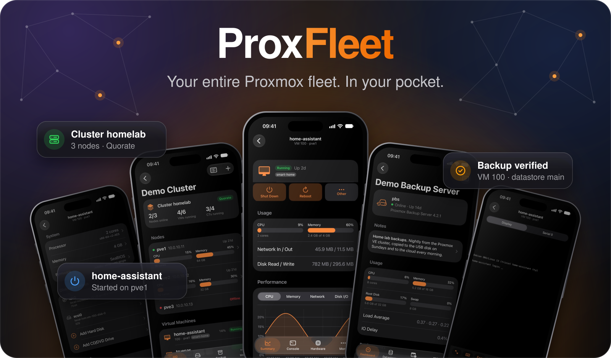
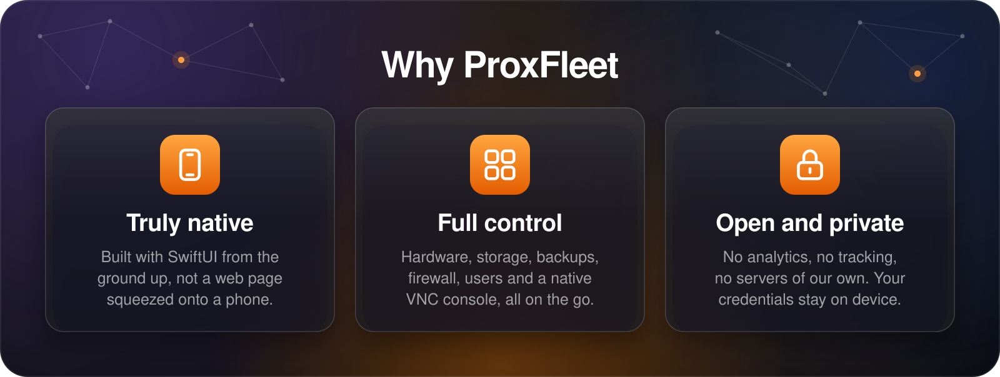
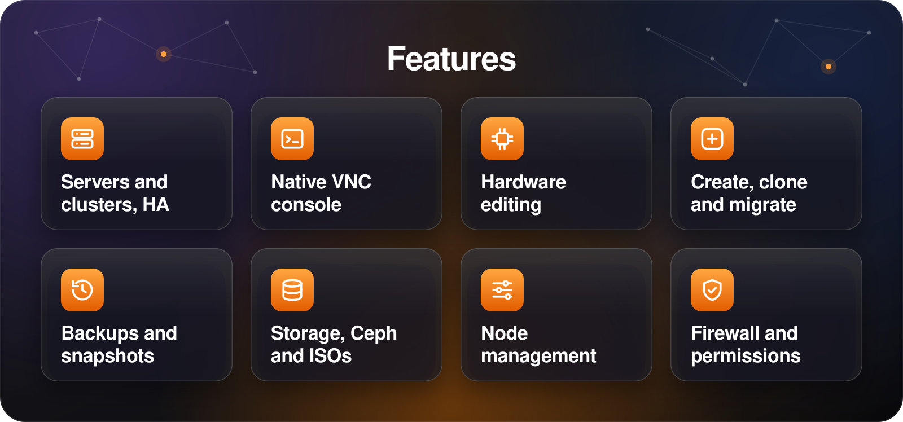
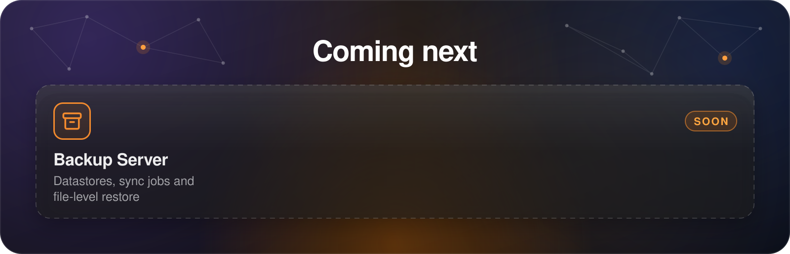

  

  A native iPhone and iPad app for managing Proxmox VE, and soon Proxmox Backup Server.

  
  
  
  
  

<!-- Replace the link with the App Store URL once the app is published. -->

  

 

  

  

  

## Contributing

ProxFleet is built in the open, and help of any size is welcome.

- **Report bugs.** Open an issue with your Proxmox VE version, your device and iOS version, and the steps that lead to the problem. Screenshots help a lot.
- **Suggest features.** Missing something from the web interface? Open an issue and tell us how you use it.
- **Test it on your setup.** Clusters with Ceph, high availability, SDN or unusual storage are hard to reproduce in a lab, so reports from real environments are especially valuable.
- **Send a pull request.** Fixes and improvements are welcome. For larger changes, please open an issue first so we can agree on the approach.

See [CONTRIBUTING.md](CONTRIBUTING.md) for building from source, running the tests and the project guidelines.

> [!IMPORTANT]
> Found a security issue? Please don't open a public issue. Report it privately through [GitHub's private vulnerability reporting](../../security/advisories/new) instead.

## Privacy

ProxFleet collects no data. It talks only to the servers you add, and your passwords stay in the iOS Keychain on your device. See the [privacy policy](PRIVACY.md).

## License

ProxFleet is free software, licensed under the [GNU General Public License v3.0 or later](LICENSE).

ProxFleet is an independent project and is not affiliated with or endorsed by Proxmox Server Solutions GmbH. Proxmox is a registered trademark of Proxmox Server Solutions GmbH.
